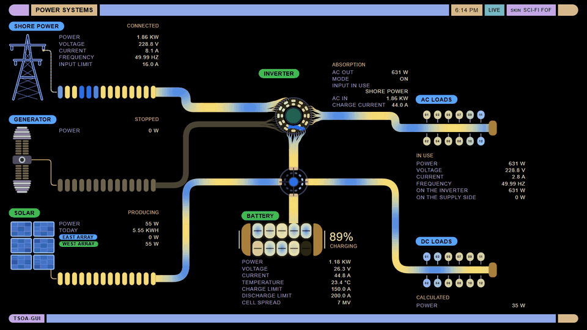
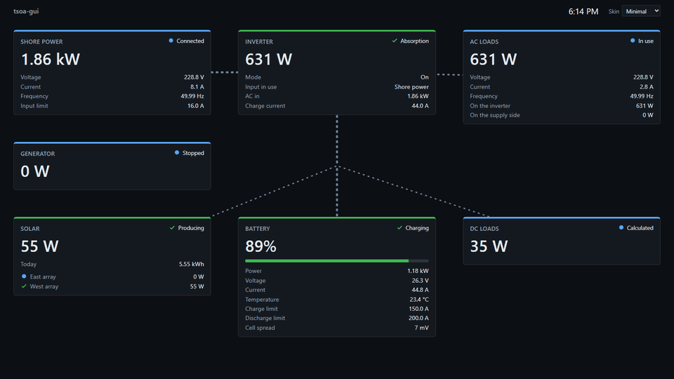
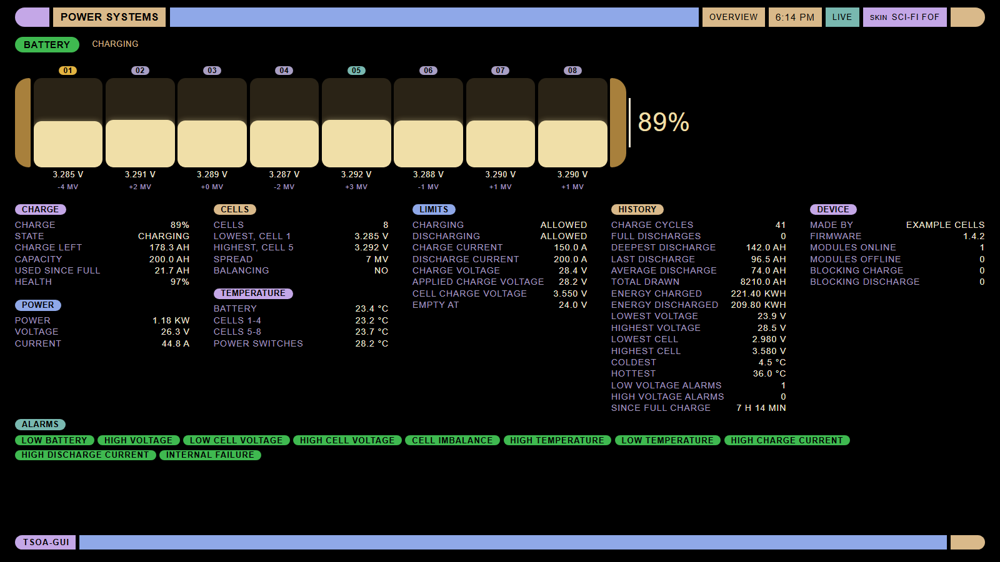
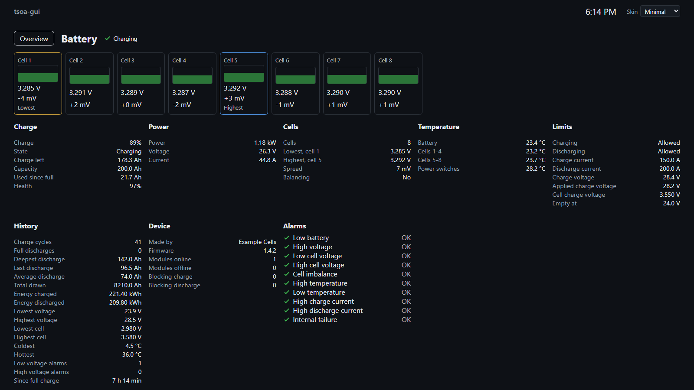
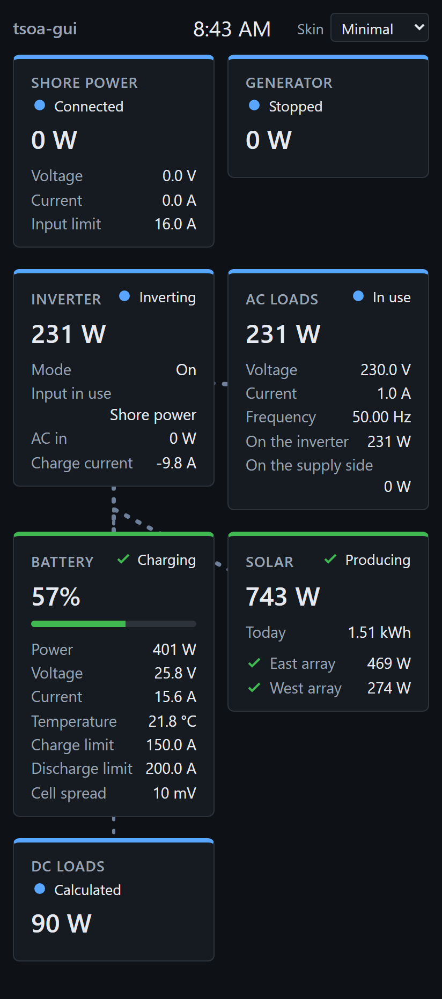

# tsoa-gui

tsoa-gui shows a Victron Energy system running Venus OS on one page: every supply, the inverter/charger, the battery and the loads, and the power moving between them, updated about once a second. It runs on the Venus OS device itself, and you open it in a browser on your own network, on a phone, a desktop or a screen on the wall.

## Features

### The overview

Each part of the system has a panel: grid or shore power, generator, inverter/charger, battery, solar, AC loads and DC loads. A panel shows what its part is doing, such as connected, charging or producing, color coded with a word or icon beside it, and the readings that are most important for it.

Animated flows join the components, moving with the flow of power. Numbers ease from one reading to the next, and if the server stops hearing from the device, or the browser loses the server, the page lets you know.

### Two skins

Sci-Fi FOF (Form Over Function) draws the system as an animated engineering console, shown at the top of this page. Waves of plasma roll along thick conduits, the inverter/charger is a hub the power winds through, and each part has artwork of its own: a transmission tower, a generator, a solar array that fills with light, a battery whose cells light with its charge.

The minimal skin is the default: plain panels, the readings in rows, and dotted lines for the flows.

Both skins show the same readings. Choose one from the menu at the top of the page, and each browser remembers its choice.

### A page for every part

Click a part to open a page with everything the device reports about it. The battery's page lists every cell it reports, with each one's voltage, its difference from the others and whether it is being balanced, then its limits, history, alarms and device details. The inverter/charger's page shows its front panel's lights, its output and input, its battery side, its settings and the energy it has moved between the supplies, the battery and the loads.

### Phones and kiosk screens

Sci-Fi FOF scales to fit the whole system on a landscape screen, from a small touch panel to a TV. The minimal skin works on a landscape screen too, scrolling where it is short, and on a phone held upright. A screen mounted on the wall can open straight onto a skin or a part's page from its address, with nobody to click. Each skin also shows the time of day, so a wall display doubles as a clock.

## Requirements

- A GX device or another device running Venus OS v3.70 or later, with root access over SSH and about 20 MB free on its data partition.
- A browser on the same network that can reach the device on port 8088: Firefox 121 or later, Chrome or Edge 117 or later, or Safari 16.4 or later, including on iPhone and iPad.

tsoa-gui runs on the Python and pydantic that Venus OS ships. Each release is tested with particular versions of them, and if a firmware update brings others, tsoa-gui will refuse to run with them instead of running untested, and its page says to install a newer release. The device's own console is unaffected either way.

## Installing

Log in to the device as root over SSH ([docs/install.md](docs/install.md#getting-root-access-over-ssh) shows how to turn it on), then paste this:

    cd /tmp
    wget https://github.com/Spikelite/tsoa-gui/releases/download/v0.2.0/tsoa-gui-0.2.0.tar.gz
    wget https://github.com/Spikelite/tsoa-gui/releases/download/v0.2.0/tsoa-gui-0.2.0.tar.gz.sha256
    sha256sum -c tsoa-gui-0.2.0.tar.gz.sha256
    tar xzf tsoa-gui-0.2.0.tar.gz
    sh tsoa-gui-0.2.0/install.sh

This downloads release 0.2.0, checks it, and installs it under `/data`, which firmware updates keep. The device needs internet access for the download, and its clock must be right for the secure connection to GitHub to work. tsoa-gui then starts at every boot. The installer ends by printing the address to open. [docs/install.md](docs/install.md) covers each step in full, along with updating, going back to the previous release and uninstalling.

## Using it

Open the address the installer printed, such as `https://192.0.2.10:8088`. tsoa-gui made a self-signed certificate for the device when it was installed, so the browser warns the first time you connect; [docs/install.md](docs/install.md#the-certificate-warning) explains the warning and how to accept it. A reverse proxy in front of tsoa-gui can present a trusted certificate instead.

For a kiosk screen, add the skin and the part to the end of that address:

| Add | Opens |
|---|---|
| `/?skin=sci-fi-fof` | the overview in Sci-Fi FOF |
| `/?skin=minimal` | the overview in the minimal skin |
| `/?skin=sci-fi-fof&part=battery` | the battery's page in Sci-Fi FOF |

The parts are `grid`, `generator`, `inverter_charger`, `battery`, `solar`, `ac_loads` and `dc_loads`. A skin named in the address wins over the one the browser remembers. On a part's page, the Overview control, the browser's back button or Escape returns to the whole system.

## Security

Viewing needs no sign-in: anyone who can reach the device on port 8088 sees every reading. Keep tsoa-gui on your own network and never forward its port to the internet. To check on the system from away, use a VPN into your network.

tsoa-gui only reads. It cannot change anything on your system, and the one message it sends to the device's MQTT broker is the keepalive that asks Venus OS to publish its readings. To report a vulnerability, see [SECURITY.md](SECURITY.md).

## Status

tsoa-gui is early, at version 0.x, and shows readings only. Controls, such as the inverter mode and the charge current, are planned behind a sign-in with roles for viewers, operators and administrators. Expect things to change between releases; only the latest one is supported.

## Contributing

Bug reports and feature requests are welcome as issues. [CONTRIBUTING.md](CONTRIBUTING.md) explains how to report a problem and how pull requests are reviewed, [docs/development.md](docs/development.md) covers building and testing, and [docs/design.md](docs/design.md) is the design brief.

## License

tsoa-gui is free for personal and other noncommercial use under the [PolyForm Noncommercial License 1.0.0](LICENSE). Commercial use needs a separate license from the copyright holder, Spikelite.

tsoa-gui is not affiliated with or endorsed by Victron Energy.
