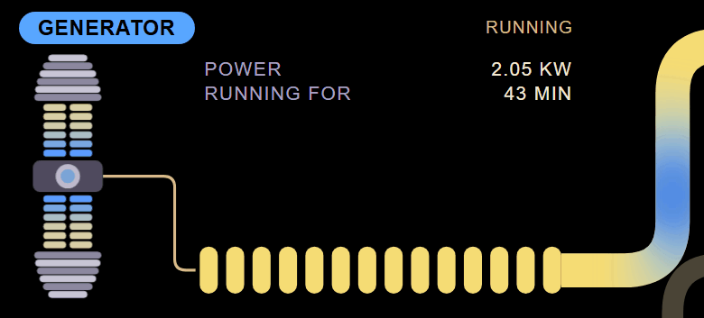
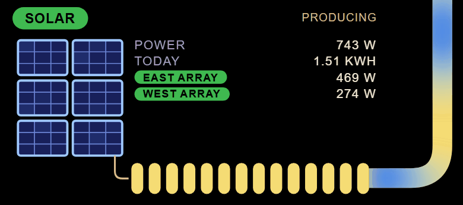
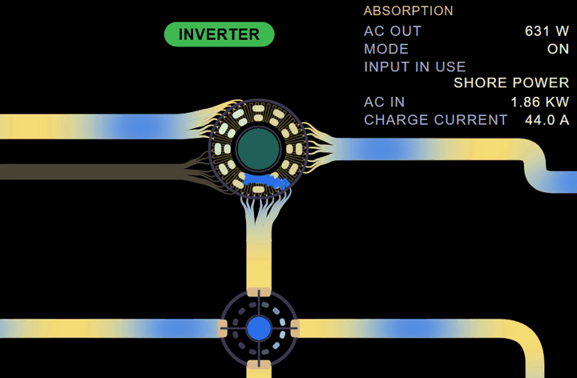

# Design

## The overview

One page is both the status board and the data view. Each part of the system has a panel showing what it is doing now:

| Part | Key readings |
|---|---|
| Grid or shore | connected or not, voltage, current, power, frequency, input current limit |
| Generator | running or stopped, power, run time |
| Inverter/charger, named Inverter on screen | mode, state (inverting, bulk, absorption, float, passthrough), AC in and out power, charge current, the AC input in use where it has two, alarms |
| Battery | state of charge, voltage, current, power, temperature, time to empty or to full, charge limits, cell spread where the battery reports cells |
| Solar | power per charger and in total, today's yield, charger state |
| AC loads | power on each output, and each circuit an energy meter of its own measures |
| DC loads | power, where it is measured |

Every skin shows the same readings for each part, from one list the skins share: a skin changes how they look, never which there are. A part the system does not have is left out. A part that is installed but not reporting is drawn as offline. Readings arrive about once a second, and every displayed value eases from its last reading to the next instead of jumping.

## Power flow and the DC bus

Power moves between the panels as animated flow whose direction and speed follow the readings. A flow with no power behind it stays drawn but still, so every part is always shown joined to the rest.

The inverter/charger, the battery, solar and the DC loads all meet at one DC bus, drawn as a junction on the line between the inverter/charger and the battery. Each is joined to the bus by its own reading, so DC loads running while the battery charges are shown fed by what comes in, not by the battery. A system whose DC side is only the battery and the inverter/charger joins those two directly.

## A page for every part

A part opens into a page of its own with everything the device reports about it, in every skin and with the same readings in each.

- The battery's page starts with every cell it reports, each with its voltage, its difference from the others and whether it is being balanced. Then come its charge, power, cells, temperatures, limits, history and device details, and every condition it watches with where each stands.
- The inverter/charger's page starts with its front panel's lights, beside its hub in Sci-Fi FOF. Then come its output and input phase by phase, its battery side and the battery limits it follows, its conditions and settings, the energy it has moved along each route between the supplies, the battery and the loads, its device details and every condition it watches.
- The grid or shore supply and the generator show what reaches the inverter/charger from their input and the energy carried from it.
- Solar shows each charger's panel and battery sides, its best power today and its harvest.
- The AC loads show what feeds them, the energy delivered to them, and each circuit an energy meter of its own measures, with its power, voltage, current, power factor and the energy it has used; the DC loads show their current at the battery's voltage.

Every page but the battery's and the inverter/charger's draws its part large, as on the overview, with its readings in groups. Clicking a part opens its page, which Sci-Fi FOF draws inside its frame, growing out of where the part sat. The page has its own address, `?part=battery`, so a kiosk can open straight onto it, and the browser's back button, Escape or the page's Overview control returns to the whole system.

## Status colors

Every skin gives color the same meaning, and pairs each state with an icon or a label so that color is never the only signal.

| State | Color | Meaning |
|---|---|---|
| Good | green | a positive condition, such as charging or solar producing |
| Normal | blue | operating as expected |
| Attention | yellow | approaching a limit |
| Warning | orange | outside the normal range |
| Fault | red | an alarm, a trip, or a limit reached |
| Offline | black | installed but not reporting, or data missing; drawn with an outline so it stays visible on a dark background |

Dark mode is the default.

## How current the readings are

Old readings are never passed off as current. The server marks the model stale when it has not heard from the device for ten seconds, and also while it cannot build a model from what it hears or the job that reads the device has stopped and is waiting to start again. The page knows when it has lost the server. Every skin says which of the three it is: live, stale, or offline.

Before the first readings arrive, the page says it is waiting. If they have not arrived after ten seconds, it says why, in plain words: the server cannot reach the device's MQTT broker, reaches it but hears nothing, or is still trying, or the page cannot reach the server at all. It links to the install guide's troubleshooting, since this is the failure someone installing for the first time is most likely to meet.

A page that has lost the server for thirty seconds asks every few seconds whether the server answers, and reloads as soon as it does, so a kiosk with nobody to click comes back by itself. It never reloads while the server does not answer, since the browser would put up its own page, which never tries again.

A page left open across an update reloads itself once the server is back running another release, or serving another build of the client, so a kiosk never runs an old client against a new server.

A skin that fails to draw is replaced by a short message saying so, and the page reloads itself ten seconds later. If it fails again within five minutes of that reload, the next wait is twice as long, up to five minutes, so a failure that comes straight back never reloads the page in a loop.

## Skins

A skin is a view over the same system model. It receives the model and its updates and decides how to draw them, and it never talks to the device itself.

### What every skin does

Every skin shows the time of day from the clock of the screen showing the page, so a wall display doubles as a clock, and every skin says how current its readings are. A viewer chooses the skin from a menu at the top of the page, and each browser remembers its choice. A fixed display, with nobody to click, names its skin in the address instead, as in `?skin=sci-fi-fof`, and that wins over the remembered choice.

Kiosk displays range from TVs and desktop monitors to a small touch panel mounted on the system, so every skin works on a landscape screen of any size. The minimal skin also works on a phone held upright; Sci-Fi FOF does not yet. A screen that asks for reduced motion gets it: the animation stops, and each flow shows its direction with arrows instead, on the line in the minimal skin and as chevrons on the conduit in Sci-Fi FOF.

The default skin ships with the page. Any other loads only when chosen, so a screen showing the default never downloads it.

### Minimal

The default is minimal and technical. Each part is a panel with its status in the corner, its headline reading large and the rest in rows, laid out stepped down from the supplies at the top to the loads at the bottom. Dotted lines join the panels, their dots moving the way the power goes, faster in steps for each tenfold rise in power. The time and the skin menu sit in the page's header, and a notice under the header appears when the readings are not live.

### Sci-Fi FOF

The second skin, Sci-Fi FOF (Form Over Function), draws the same diagram as an engineering console. All of its artwork is original, drawn in CSS and SVG.

#### The frame

The console sits in a frame. Its top bar carries the time, a segment that reads Live, Stale or Offline, and the skin choice, which drops down as a list of segments; on a part's page it also carries the way back to the overview. The bottom bar carries the application's name. The console scales with the screen's height as well as its width, so the whole of it fits on anything from a small touch panel to a TV.

#### Parts and conduits

Every part keeps its place from the minimal skin and sits on black with no box of its own, named by a rounded button in its status's color, with the status written after the name when it needs attention.

Thick conduits with rounded elbows plug into each part's name or its equipment. Waves of plasma roll along them toward where the power goes, more often and faster the more power each carries. A part that exists but carries nothing just now keeps a dim, still conduit. A conduit changes between the two with its waves, never all at once: going idle, the waves on it roll on to its end with the dim conduit behind the last, and going active, new waves set off from its source and light it as they pass. Each wave carries the state its source was in as it set off. The hub's threads, the DC bus relay and the equipment at either end change as the change reaches them. With reduced motion there are no waves, so the change shows at once.

#### The supplies

The grid is a schematic of a tall lattice transmission tower, drawn in outline, with a wire carrying a steady blue flow down to a row of pips that power drips into. The pips nearest the wire turn blue in turn, and before the third is full the charge sets off down the row as a packet and into the grid's conduit. The grid's readings sit in the space above the row.

The generator is a schematic of a column of cells between ribbed caps round a housing, ring and dot, with a cable to a row of pips like the grid's. While it runs, blue light runs in from both ends, meets in the dot, then runs down the cable and along the pips into its conduit.

Solar is a schematic of an array of six panels, each a grid of cells that gather light until the array is full. The light then runs down a cable into a row of pips like the grid's and into the conduit.

#### The inverter/charger hub

The inverter/charger is a hub that power runs through. Its core's ring of cells is wound all the way round in one even coil, like a transformer's, and the coil is see-through, so the core's cells pulse through it.

Each conduit that meets the hub carries on as three threads of itself, with its own body and waves. The threads curve round toward the coil and each fork into three, narrowing into the coil at nine joins on the turns nearest where the conduit lands. So the waves pour from the supplies' conduits into the coil, run on round it and leave through the threads of what they feed, and power from a supply straight to the AC loads is drawn through the hub with the rest.

At the hub's center a solid light in the core's color pulses at its own pace, quicker the more power the unit handles. The core's color follows what the inverter/charger is doing. On an inverter/charger with two AC inputs, the grid or shore supply and the generator meet the hub's left side apart, each where the input it is wired to is, AC input 1 above and AC input 2 below.

#### The DC bus relay

The DC bus junction is a plasma relay. Pulses pass through it on their way between its conduits, and its core and cells light with them.

#### The battery and the loads

The battery is one block of ten cells that light with its charge, a tenth each, with pulses of plasma running through them at the rhythm of the conduits' waves. The cells light from the middle of the top row, where its conduit feeds it, outward, then from the middle of the next row.

The AC loads and the DC loads are each a circuit panel: the conduit feeding them runs on along its bus to a terminal block, with two rows of breakers tapped off it, each lit by the plasma as a wave on the bus reaches its tap.

#### Small screens

A small screen keeps the motion but drops the cells' glow, the part that costs the most to draw, so the skin stays smooth on a small panel without cutting its effects back everywhere.

## Control and users

Viewing is read-only and needs no sign-in for now: anyone who can reach the server sees the readings, and a fixed display just opens the page. Nobody can change anything without signing in.

The interface will also control the system, starting with inverter mode, AC input current limit and charge current. What a signed-in user may do depends on their role: read-only viewers, operators with day-to-day controls, and administrators with everything including users and settings. The first account made on a new installation is its administrator. More roles may follow.

The device's own login grants full control, so roles are enforced by a server between the browser and the device. It holds the device connection, signs users in, and checks every change against the user's role.

## Data

Readings come from Venus OS's MQTT feed, the one the device's own console uses. The model is built from the system summary service where it can be, so one build works across installations without per-device setup.
